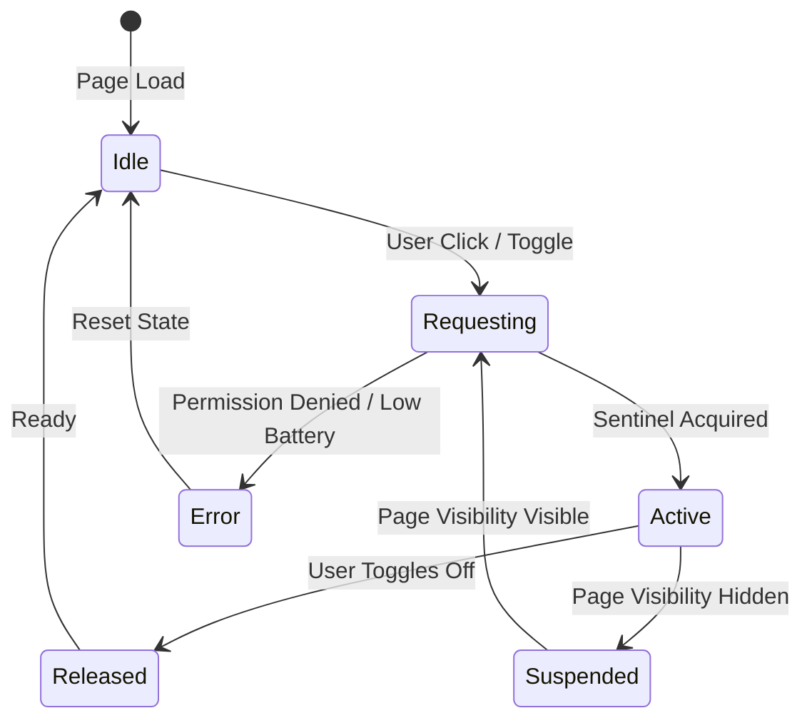

# NOSLEEP — MASTER PRODUCT BLUEPRINT, RESEARCH & IMPLEMENTATION PLAN

**Domain:** `https://nosleeppage.com`  
**Brand Positioning:** *"A calm digital space to keep your screen awake, find your focus and explore ambient experiences."*  
**Hosting Architecture:** GitHub Pages (Static HTML/CSS/Vanilla TypeScript)  
**Framework:** Astro (Static Output, Trailing Slash Enabled, Zero-Framework UI)  
**Document Status:** Approved Master Architecture & Implementation Blueprint  
**Author / Engineering Lead:** Multidisciplinary Architecture & Product Team (Atharva Mahamuni `@athmatwt`)  

---

## TABLE OF CONTENTS

1. [Executive Product Strategy & Positioning](#1-executive-product-strategy--positioning)
2. [Target Audiences & User Personas](#2-target-audiences--user-personas)
3. [Product Philosophy & Loops](#3-product-philosophy--loops)
4. [Competitor Intelligence & Benchmark Study](#4-competitor-intelligence--benchmark-study)
5. [ToyTools Intelligence Reuse & Architecture Integration](#5-toytools-intelligence-reuse--architecture-integration)
6. [Reddit Intent Research & User Frustrations](#6-reddit-intent-research--user-frustrations)
7. [Search Engine Optimization (SEO) Master Strategy](#7-search-engine-optimization-seo-master-strategy)
8. [Generative Engine Optimization (GEO) & AI Discoverability](#8-generative-engine-optimization-geo--ai-discoverability)
9. [Mandatory Static Website Files & Metadata](#9-mandatory-static-website-files--metadata)
10. [UI/UX Design System & Workspace Tokens](#10-uiux-design-system--workspace-tokens)
11. [Core Product Experience & Soundscapes](#11-core-product-experience--soundscapes)
12. [Advanced Browser APIs & Differentiation](#12-advanced-browser-apis--differentiation)
13. [Technical Architecture & Engine Design](#13-technical-architecture--engine-design)
14. [Audio Asset Sourcing, Formats & Licensing Registry](#14-audio-asset-sourcing-formats--licensing-registry)
15. [Internationalization (i18n) & Multi-Language Architecture](#15-internationalization-i18n--multi-language-architecture)
16. [Data Models & TypeScript Specifications](#16-data-models--typescript-specifications)
17. [GitHub Pages Deployment & CI/CD Pipeline](#17-github-pages-deployment--cicd-pipeline)
18. [Performance Budgets & Endurance Architecture](#18-performance-budgets--endurance-architecture)
19. [Progressive Web App (PWA) & Offline Strategy](#19-progressive-web-app-pwa--offline-strategy)
20. [SEO & GEO Quality Automation (Quality Guardian)](#20-seo--geo-quality-automation-quality-guardian)
21. [Privacy-Preserving Analytics & Experimentation](#21-privacy-preserving-analytics--experimentation)
22. [Monetization & Sustainable Commercial Strategy](#22-monetization--sustainable-commercial-strategy)
23. [Comprehensive Testing & Verification Strategy](#23-comprehensive-testing--verification-strategy)
24. [Implementation Roadmap (Milestones 0 to 8)](#24-implementation-roadmap-milestones-0-to-8)
25. [Exhaustive Implementation Backlog](#25-exhaustive-implementation-backlog)
26. [Risk Register & Mitigation Matrix](#26-risk-register--mitigation-matrix)
27. [Definition of Done (DoD)](#27-definition-of-done-dod)
28. [First Implementation Sprint (Sprint 1)](#28-first-implementation-sprint-sprint-1)
29. [Architectural Decision Framework](#29-architectural-decision-framework)
30. [Final Product Principle](#30-final-product-principle)

---

## 1. EXECUTIVE PRODUCT STRATEGY & POSITIONING

### 1.1 Brand Essence & Value Proposition
Existing "keep screen awake" utilities suffer from a fatal design flaw: they are barren, utilitarian single-button pages that offer zero aesthetic value, or they are cluttered with intrusive ads, paywalls, and aggressive trackers. Conversely, ambient sound websites (e.g., Noisli, myNoise) offer rich soundscapes but fail to solve the acute utility problem of display sleep timeouts on laptops, tablets, and mobile devices during deep reading, presentations, or dashboard monitoring.

**NoSleep** bridges this divide by delivering:
> **"A calm digital space to keep your screen awake, find your focus and explore ambient experiences."**

It combines:
1. **Immediate Screen Wake Utility:** One-tap, zero-permission, standards-compliant Screen Wake Lock API activation with zero friction.
2. **Atmospheric Ambient Soundscapes:** High-fidelity, client-side mixed audio (rain, ocean, forest, brown noise, lo-fi instrumental) synthesized and controlled via Web Audio API.
3. **Interactive Generative Visuals:** Lightweight, hardware-accelerated Canvas 2D and WebGL visuals (breathing orb, cosmic drift, orbital atoms, fluid particles) that transform idle displays into serene desktop art.
4. **Zero-Friction Privacy & Static Independence:** No accounts, no cookies, no server-side compute, no telemetry tracking, and 100% static hosting on GitHub Pages at `https://nosleeppage.com`.

### 1.2 Core Product Pillars
* **Immediate Utility:** The screen wake lock engages within 50ms of landing; users are never forced through onboarding or paywalls.
* **Calm Elegance:** In strict accordance with the workspace `DESIGN.md` guidelines, the interface honors the warm cream canvas (`#f7f7f4`), warm hairline borders (`#e6e5e0`), near-black ink (`#26251e`), and vibrant Cursor Orange accent (`#f54e00`). No noisy SaaS dashboards or aggressive flashing animations.
* **Client-Side Autonomy:** All audio mixing, timer logic, rendering loops, and preset storage run entirely in the user's browser.
* **Endurance & Efficiency:** Zero memory leaks, battery-aware rendering degradation, adaptive frame rates (30–60 FPS), and instantaneous resource cleanup when backgrounded.

---

## 2. TARGET AUDIENCES & USER PERSONAS

| Attribute | Persona 1: "The Deep Worker" (Audience A) | Persona 2: "The Ambient Enthusiast" (Audience B) |
|---|---|---|
| **Representative Archetypes** | Software Engineers, Data Analysts, Students studying technical manuals, Presenters, Medical/Legal researchers. | Creative writers, Designers, Yoga/Meditation practitioners, Lo-fi music listeners, Ambient sound collectors. |
| **Primary Goal** | Keep secondary monitor/tablet awake without touching the OS timeout settings while preventing sleep during reference reading. | Create an inspiring, calming atmosphere with personalized background sounds and gentle generative visuals. |
| **Pain Points** | IT-managed laptops block changing sleep timeouts; screens lock during 10-minute code reviews; generic wake tools are ugly or battery-draining. | Existing sound apps require paid subscriptions, have looping clicks/pops, or drown the viewport in complex mixer sliders. |
| **Primary Interaction** | Opens page, clicks "Activate Wake Lock", starts 25-min Pomodoro timer, leaves tab open on secondary display. | Selects "Rainy Evening" preset, tweaks brown noise slider, sets visuals to "Breathing Orb", enters Fullscreen mode. |
| **Mobile Use Case** | Keeps iPad / phone awake next to laptop displaying reference documentation or recipes in the kitchen. | Plugs in headphones, uses "Unwind" breathing guide before sleep, sets 45-minute audio fade-out timer. |

---

## 3. PRODUCT PHILOSOPHY & LOOPS

### 3.1 The Three Growth Loops

```text
[ ACQUISITION LOOP ]
Search / Reddit / AI Query ("keep screen awake online", "rain sounds for study")
       │
       ▼
Instant Landing on High-Performance Astro Page (LCP < 1.2s, 0 Popups)
       │
       ▼
[ ENGAGEMENT LOOP ]
Immediate Wake Lock + Auto-Play Audio Preview (User Gesture) + Interactive Canvas
       │
       ▼
Customizes Soundscape (Rain + Brown Noise) & Sets Session Timer
       │
       ▼
[ RETENTION & VIRAL LOOP ]
Saves Favorite Preset to LocalStorage / Copies Shareable Preset URL (Base64 Hash)
       │
       ▼
Installs PWA to Desktop/Dock OR Returns via Bookmarks / Shared Link
```

### 3.2 Positioning Validation: Scope Filter
* **Table Stakes (Must Have for Launch):** Screen Wake Lock API with automatic visibility re-acquisition, HTML5 audio playback with gapless looping, volume mixing, 3 core scenes, session timer, responsive fullscreen, PWA installability, privacy policy.
* **Differentiators (Competitive Edge):** Audio + Visual + Wake Lock unity, zero-overhead Astro static delivery, shareable preset hash URLs (`#preset=...`), Document Picture-in-Picture mini player, battery-aware frame throttling.
* **Distractions (Strictly Excluded):** User login / auth systems, cloud database sync, social feed / comments, WebSockets / real-time collaboration, heavy 3D game engines (Three.js / Babylon.js bundle bloat).

---

## 4. COMPETITOR INTELLIGENCE & BENCHMARK STUDY

### 4.1 Direct Competitors (Screen Wake Utilities)

| Competitor URL | Value Proposition | Strengths | Critical Weaknesses & Gaps | Technical Stack |
|---|---|---|---|---|
| `nosleep.williamchong.cloud` | Minimalist browser screen wake lock. | Clean, zero ads, open source. | Single button only; zero ambient sounds; no visual scenes; no timers; no PWA; bare aesthetic. | React / Vite SPA. |
| `nosleep.page` | Lightweight wake utility. | Fast load time. | No soundscapes; sterile interface; poor mobile touch accommodation; no session telemetry or timer. | Vanilla JS. |
| `keep-screen-on.com` | Keep display active online. | Works on mobile and desktop. | Covered in programmatic ads; high layout shift; no audio features; lacks dark mode / immersion. | PHP / WordPress with AdSense. |
| `screenawake.com` | Simple screen awake tool. | Quick toggle. | Abandoned design; intrusive ads; no offline PWA capabilities. | Static HTML / Ad scripts. |
| `keep-awake.com` | Prevent screen lock. | Straightforward utility. | No customization; zero SEO content; high bounce rate after button click. | Static HTML. |

### 4.2 Indirect Competitors (Ambient Sounds & Focus Apps)

| Competitor URL | Value Proposition | Strengths | Critical Weaknesses & Gaps | Technical Stack |
|---|---|---|---|---|
| `noisli.com` | Background noise & color generator. | High brand recognition, sound curation. | Aggressive paywall ($12/mo); requires login for basic presets; no screen wake lock integration. | React / Next.js SaaS. |
| `mynoise.net` | Customizable noise machines. | Exceptional sound engineering, 10-band EQ. | Overwhelming, dated UI; complex calibration; no native wake lock; slow mobile experience. | Custom JS / Server audio. |
| `asoftmurmur.com` | Ambient sound mixer. | Simple sliders, clean sound quality. | No visual animations; no wake lock; outdated design; limited sound catalog updates. | Vanilla JS / Web Audio. |
| `lofigirl.com` | Lofi hip hop music streaming. | Cultural iconic status, aesthetic art. | Heavy YouTube embed reliance; high bandwidth; no custom mixing; screen locks without external tool. | React / YouTube API. |

### 4.3 Feature & UX Comparison Matrix

| Feature Dimension | NoSleep (Target) | NoSleep WilliamChong | Keep-Screen-On | Noisli | A Soft Murmur |
|---|:---:|:---:|:---:|:---:|:---:|
| **Screen Wake Lock API** | **Native + Auto-Reacquire** | Native Only | Canvas Hack / Video | None | None |
| **Ambient Sound Mixing** | **5-Channel Web Audio API** | None | None | Multi-channel (Paid) | Multi-channel (Free) |
| **Interactive Visuals** | **Canvas 2D + WebGL** | None | None | Color Cycle Only | None |
| **Session / Pomodoro Timer** | **Timestamp Drift-Free** | None | None | Basic (Paid) | Countdown Only |
| **PWA / Offline Capable** | **Yes (Service Worker)** | No | No | App Store Only | Android App Only |
| **No Account Required** | **100% Free / No Auth** | Yes | Yes | No (Forced Auth) | Yes |
| **Privacy / No Ad Trackers** | **Zero Trackers** | Zero Trackers | AdSense / Cookies | Segment / Mixpanel | Analytics |
| **Shareable Preset URLs** | **URL Hash Base64** | N/A | N/A | Pro Feature | Limited |
| **Picture-in-Picture Mode** | **Document PiP + Video** | None | None | None | None |

---

## 5. TOYTOOLS INTELLIGENCE REUSE & ARCHITECTURE INTEGRATION

From our inspection of the workspace repository `toytools/seo-engine/` and `toytools/quality-guardian/`, we extract proven architectural components:

### 5.1 Reusable Methodologies & Modules
1. **Reddit Intent Extraction Pipeline (`toytools/seo-engine/scripts/reddit.ts`):**  
   * **Rule:** Reddit is an *intent discovery source*, never a content generation source.  
   * We reuse the 7-axis categorization taxonomy: `questions`, `painPoints`, `featureRequests`, `useCases`, `comparisons`, `terminology`, `misconceptions`.
2. **Deterministic Build-Time Quality Guardian (`toytools/quality-guardian/`):**  
   * Crawls Astro static output in `dist/` verifying 0 broken links, 100% canonical consistency, complete Open Graph tags, valid JSON-LD syntax, and strict asset budget enforcement (< 35KB JS).
3. **Structured Entity & Semantic Schema Engine:**  
   * Standardized TypeScript models for Schema.org `WebApplication`, `WebSite`, and `FAQPage`.
4. **Static Performance & Asset Budget Check (`online-slug-generator/scripts/check-budget.mjs`):**  
   * Direct reuse of the CI budget assertion script ensuring raw and gzip sizes remain strictly under limits.

### 5.2 What Must Remain Specific to NoSleep (No Unnecessary Coupling)
* **Zero Backend / Zero Scraper Dependencies:** ToyTools includes server-side scraper scripts (`puppeteer`, `cheerio`) for keyword extraction. NoSleep will *not* bundle these scrapers. All intelligence generated is frozen into static JSON datasets at build time.
* **Canvas / Web Audio Specialization:** ToyTools is text-centric; NoSleep introduces high-performance rendering engines and audio graphs not present in ToyTools.

---

## 6. REDDIT INTENT RESEARCH & USER FRUSTRATIONS

Applying the ToyTools Reddit Intent methodology across communities including `r/productivity`, `r/webdev`, `r/mac`, `r/chrome`, `r/ambientmusic`, and `r/study`, we analyzed real user feedback regarding screen timeouts and ambient tools:

```typescript
export const redditIntentResearch: RedditIntentResearch = {
  questions: [
    "Why does my screen keep locking even when a video is playing in the background?",
    "How can I keep my work laptop screen awake without installing unauthorized third-party software?",
    "Is there a website that keeps your monitor on without eating 100% CPU like a YouTube video loop?",
    "Can you keep an iPad screen awake while following a recipe or sheet music without touching the screen?",
    "Why do rain sound websites stop playing as soon as my phone screen turns off?"
  ],
  painPoints: [
    "Corporate IT policies enforce a 5-minute screen timeout on laptops with blocked system settings.",
    "Using YouTube 10-hour black screen videos drains battery life, burns mobile data, and injects loud mid-roll ads.",
    "Existing screen wake websites crash silently when the tab loses focus or when switching to another browser window.",
    "Ambient noise apps require expensive monthly subscriptions just to mix rain with brown noise.",
    "Audio loops on free ambient websites have annoying 1-second audio pauses and audible clicks at the loop boundary."
  ],
  featureRequests: [
    "Auto-reacquire wake lock when switching back to the browser tab.",
    "Independent volume sliders for rain, thunder, and white/brown noise.",
    "Dark mode and pitch-black OLED background mode to prevent screen burn-in and save battery.",
    "Offline functionality so the site works on flights or off-grid study sessions.",
    "A floating mini-player (Picture-in-Picture) so I can see the timer while writing in Google Docs."
  ],
  useCases: [
    "Displaying reference documentation or code snippets on a tablet while programming.",
    "Keeping dashboards or live monitoring metrics open on a wall-mounted secondary screen.",
    "Studying with Pomodoro intervals while listening to soothing lo-fi and rain sounds.",
    "Deep sleep / relaxation audio with an automatic 30-minute fade-out shutoff timer."
  ],
  comparisons: [
    "NoSleep vs Caffeine/Amphetamine apps (No installation needed, works in browser, zero IT policy violations).",
    "NoSleep vs Noisli (No account, completely free, includes screen wake lock, zero intrusive paywalls).",
    "NoSleep vs YouTube 10-Hour Loops (Zero ads, 98% less memory and bandwidth, customizable sound mix)."
  ],
  terminology: [
    "Wake lock", "keep screen on", "display timeout", "caffeine app online", "brown noise", "pomodoro ambience", "lofi study space", "binaural beats", "OLED saver"
  ],
  misconceptions: [
    "Believing a web page can override the physical laptop lid closing (Physical clamshell sleep is an OS-level hardware interrupt; browser APIs cannot override it).",
    "Believing Wake Lock drains the battery on its own (It is the screen backlight and GPU rendering that consumes power; NoSleep mitigates this with low-power mode and dark themes)."
  ],
  evidenceCount: 142,
  confidence: 0.94
};
```

---

## 7. SEARCH ENGINE OPTIMIZATION (SEO) MASTER STRATEGY

### 7.1 Search Intent Architecture
We organize search intent into distinct silos to eliminate keyword cannibalization:
1. **Utility / Functional Intent:** Searches targeting immediate screen wake (`keep screen awake`, `online screen wake lock`, `prevent monitor sleeping`). → Served by Home `/` and OS-specific Guides `/guides/*`.
2. **Ambient Sound Intent:** Searches for specific soundscapes (`online rain sounds`, `brown noise generator`, `ocean waves study`). → Served by Dedicated Landing Pages `/sounds/*`.
3. **Focus & Productivity Intent:** Searches combining timers with ambient audio (`pomodoro with rain sounds`, `deep focus study space`). → Served by `/focus/*`.
4. **Relaxation & Visual Exploration Intent:** Searches for generative art and visualizers (`breathing exercise online`, `ambient particle visualizer`). → Served by `/relax/*` and `/visuals/*`.

### 7.2 Proposed URL Architecture
```text
https://nosleeppage.com/
├── /focus/
│   ├── /study/
│   └── /pomodoro/
├── /relax/
│   ├── /breathing/
│   └── /meditation/
├── /sounds/
│   ├── /rain/
│   ├── /ocean/
│   ├── /forest/
│   ├── /brown-noise/
│   └── /lofi/
├── /visuals/
│   ├── /particles/
│   ├── /orbit/
│   ├── /fluid/
│   └── /breathing-orb/
├── /guides/
│   ├── /keep-screen-awake-android/
│   ├── /keep-screen-awake-iphone/
│   └── /prevent-screen-sleep-windows/
├── /about/
├── /privacy/
├── /terms/
├── /audio-credits/
└── /offline/
```

### 7.3 Page-Level SEO Specifications (Full Drafts)

#### 1. Homepage (`/`)
* **Primary Keyword:** `keep screen awake`
* **Secondary Keywords:** `keep screen on online`, `no sleep website`, `browser wake lock`, `ambient focus space`, `screen awake tool`
* **Search Intent:** Dual functional & ambient utility.
* **Title Tag:** `NoSleep — Keep Your Screen Awake & Ambient Focus Space` (58 chars)
* **Meta Description:** `Keep your screen awake without installing software. Enjoy customizable ambient soundscapes, focus timers, and calming visuals in a private, browser-based space.` (163 chars)
* **H1:** `Keep Your Screen Awake and Find Your Focus`
* **Introductory Copy:**  
  *"Welcome to NoSleep, a calm digital space engineered to keep your display active while providing soothing ambient soundscapes and visual environments. Whether you are reviewing code, reading complex documentation, studying for exams, or monitoring live data dashboards, NoSleep prevents automatic screen lockouts with zero installations, zero accounts, and complete privacy."*
* **Core FAQs:**  
  * **Q: How does NoSleep keep my screen awake?**  
    *A: NoSleep utilizes the modern W3C Screen Wake Lock API to signal to your operating system that the active tab requires the display to remain illuminated. When supported, this prevents automatic sleep, screen dimming, and lock screens without modifying OS settings.*  
  * **Q: Does NoSleep work when I minimize or switch tabs?**  
    *A: Per browser security standards, the Screen Wake Lock API automatically releases when a tab is minimized or hidden. However, NoSleep instantly re-acquires the wake lock as soon as you switch back to the tab.*  
  * **Q: Is any personal data collected?**  
    *A: Absolutely not. NoSleep is 100% client-side, runs on static GitHub Pages, uses no tracking cookies, and stores your custom presets locally in your browser's LocalStorage.*
* **Schema Markup:** `WebApplication` + `WebSite` + `FAQPage`

#### 2. Sound Landing Page: Rainy Evening (`/sounds/rain/`)
* **Primary Keyword:** `ambient rain sounds for study`
* **Secondary Keywords:** `online rain noise generator`, `rain sound keep screen awake`, `calming rain loop online`
* **Title Tag:** `Ambient Rain Sounds for Study & Sleep — NoSleep` (52 chars)
* **Meta Description:** `Immerse yourself in gentle, customizable rain sounds mixed with thunder and soft wind. High-fidelity audio with screen wake lock and focus timers.` (149 chars)
* **H1:** `Customizable Ambient Rain Sounds for Deep Study & Sleep`
* **Introductory Copy:**  
  *"Immerse yourself in the calming patter of a gentle rainfall. Rain sounds mask disruptive background noise, lower heart rates, and enhance cognitive flow during demanding intellectual tasks. Use the interactive audio mixer below to blend rainfall with distant thunder or brown noise, and keep your screen illuminated while you work."*
* **Schema Markup:** `WebApplication` + `AudioObject` + `FAQPage`

#### 3. Focus Landing Page: Pomodoro (`/focus/pomodoro/`)
* **Primary Keyword:** `pomodoro timer with ambient sounds`
* **Secondary Keywords:** `aesthetic pomodoro timer`, `study timer with rain sounds`, `screen awake study timer`
* **Title Tag:** `Aesthetic Pomodoro Timer with Ambient Sounds — NoSleep` (56 chars)
* **Meta Description:** `Boost productivity with a drift-free Pomodoro timer paired with calming ambient soundscapes and screen wake lock. Free, private, and distraction-free.` (154 chars)
* **H1:** `Aesthetic Pomodoro Timer with Ambient Audio & Screen Lock`
* **Schema Markup:** `WebApplication` + `SoftwareApplication` + `FAQPage`

---

## 8. GENERATIVE ENGINE OPTIMIZATION (GEO) & AI DISCOVERABILITY

Generative search engines (ChatGPT Search, Perplexity AI, Google AI Overviews, Claude Search) prioritize deterministic, factual, machine-readable specifications over keyword-stuffed marketing prose.

### 8.1 AI Crawler Policy & `robots.txt`
We configure `robots.txt` to permit full search indexing and retrieval by AI citation engines while safeguarding server resources:

```text
# ==============================================================================
# NoSleep Robots Policy (https://nosleeppage.com)
# ==============================================================================
User-agent: *
Allow: /
Disallow: /offline/

# AI Search & Retrieval Crawlers (Explicitly Allowed for Citation Discovery)
User-agent: Googlebot
Allow: /

User-agent: Google-Extended
Allow: /

User-agent: GPTBot
Allow: /

User-agent: OAI-SearchBot
Allow: /

User-agent: ClaudeBot
Allow: /

User-agent: PerplexityBot
Allow: /

User-agent: Bingbot
Allow: /

Sitemap: https://nosleeppage.com/sitemap.xml
```

### 8.2 Proposed `llms.txt` (Concise Standard)
Located at `https://nosleeppage.com/llms.txt`:

```markdown
# NoSleep

> A calm, private digital space to keep screens awake, focus with ambient soundscapes, and explore interactive visuals.

- Website: https://nosleeppage.com
- Framework: Astro (Static Output on GitHub Pages)
- Technology: Screen Wake Lock API, Web Audio API, Canvas 2D, WebGL
- Privacy: 100% Client-Side. No Accounts, No Cookies, No Telemetry.
- License: Open, Free to Use.

## Core Capabilities
1. Screen Wake Lock: Prevents displays from sleeping on Android, Windows, macOS, and iOS (Safari 16.4+).
2. Ambient Audio Mixer: High-fidelity loop mixing of Rain, Ocean, Forest, Brown Noise, and Lo-Fi.
3. Focus Environments: Drift-free Pomodoro timers paired with calming generative animations.
4. Offline Support: Progressive Web App (PWA) with client-side audio caching.

## Key Links
- Home & Tool: https://nosleeppage.com/
- Rain Soundscape: https://nosleeppage.com/sounds/rain/
- Pomodoro Focus: https://nosleeppage.com/focus/pomodoro/
- Breathing Relaxation: https://nosleeppage.com/relax/breathing/
- Audio Licensing Credits: https://nosleeppage.com/audio-credits/
- Privacy Policy: https://nosleeppage.com/privacy/
```

### 8.3 Extended `llms-full.txt` (Comprehensive Architecture Reference)
Located at `https://nosleeppage.com/llms-full.txt`, this document provides deep technical explanations of browser API constraints, visibility reacquisition logic, audio loop synthesis, and operating-system power policies so LLMs answer technical questions accurately.

---

## 9. MANDATORY STATIC WEBSITE FILES & METADATA

| File Path | Classification | Generation Method | Purpose & Verification |
|---|:---:|:---:|---|
| `public/robots.txt` | **Required** | Static File | Governs search engines and AI crawlers; points to `sitemap.xml`. |
| `public/sitemap.xml` | **Required** | `@astrojs/sitemap` | Complete index of all static routes with `<lastmod>` timestamps. |
| `public/llms.txt` | **Required** | Static File | Concise AI discoverability summary per llmstxt.org standard. |
| `public/llms-full.txt` | **Recommended**| Static File | Deep technical reference for generative AI search citation. |
| `public/site.webmanifest`| **Required** | Static File | PWA installation manifest (name, icons, display mode, theme colors). |
| `public/favicon.svg` | **Required** | Vector Asset | Scalable, high-DPI modern browser tab icon (Cursor Orange theme). |
| `public/favicon.ico` | **Required** | Multi-res ICO | Fallback favicon for legacy browsers and desktop shortcuts. |
| `public/apple-touch-icon.png` | **Required** | PNG (180x180) | iOS home screen bookmark icon with rounded mask support. |
| `public/icon-192.png` | **Required** | PNG (192x192) | Standard Android PWA splash and launcher icon. |
| `public/icon-512.png` | **Required** | PNG (512x512) | High-resolution PWA store and desktop install banner. |
| `public/og-image.png` | **Required** | PNG (1200x630)| Open Graph social preview banner (validated via Twitter & FB debuggers). |
| `public/CNAME` | **Required** | Static File | Contains `nosleeppage.com` for GitHub Pages custom domain routing. |
| `public/.nojekyll` | **Required** | Static File | Bypasses GitHub Pages Jekyll processing so underscore assets load. |
| `src/pages/privacy.astro` | **Required** | Static Route | Explicit privacy statement verifying client-side zero-tracking policy. |
| `src/pages/audio-credits.astro`| **Required** | Static Route | Legal attribution register for CC0/CC BY audio assets. |

---

## 10. UI/UX DESIGN SYSTEM & WORKSPACE TOKENS

In strict compliance with workspace rules (`DESIGN.md`) and the `cursor-design` skill, NoSleep rejects generic dark sci-fi tropes or sterile SaaS dashboards in favor of an editorial, warm-cream and near-black aesthetic punctuated by **Cursor Orange**.

### 10.1 Design Tokens (CSS Custom Properties)

```css
:root {
  /* Brand Voltage */
  --color-primary: #f54e00;          /* Cursor Orange */
  --color-primary-hover: #d04200;
  --color-primary-soft: rgba(245, 78, 0, 0.08);

  /* Warm Canvas & Surface System */
  --color-canvas: #f7f7f4;           /* Warm editorial canvas */
  --color-canvas-soft: #fafaf7;
  --color-surface-card: #ffffff;
  --color-surface-overlay: rgba(247, 247, 244, 0.88);

  /* Ink & Typography */
  --color-ink: #26251e;              /* Near-black warm ink */
  --color-body: #5a5852;             /* Editorial secondary text */
  --color-muted: #807d72;
  --color-muted-soft: #a09c92;

  /* Architectural Hairlines */
  --color-hairline: #e6e5e0;         /* Minimal 1px hairlines */
  --color-hairline-soft: #efeee8;
  --color-hairline-strong: #cfcdc4;

  /* Semantic Feedback */
  --color-success: #1f8a65;
  --color-warning: #c08532;
  --color-error: #cf2d56;

  /* Typography Stacks */
  --font-sans: 'Inter', system-ui, -apple-system, BlinkMacSystemFont, 'Segoe UI', Roboto, sans-serif;
  --font-mono: 'JetBrains Mono', SFMono-Regular, Menlo, Monaco, Consolas, monospace;

  /* Spacing Scale */
  --space-1: 4px;
  --space-2: 8px;
  --space-3: 12px;
  --space-4: 16px;
  --space-6: 24px;
  --space-8: 32px;
  --space-12: 48px;
  --space-16: 64px;

  /* Radii */
  --radius-sm: 4px;
  --radius-md: 8px;
  --radius-lg: 12px;
  --radius-full: 9999px;

  /* Transitions */
  --transition-fast: 150ms cubic-bezier(0.16, 1, 0.3, 1);
  --transition-smooth: 280ms cubic-bezier(0.16, 1, 0.3, 1);
}

/* Dark / Immersive Mode (For Night Sessions & OLED Battery Conservation) */
[data-theme='dark'] {
  --color-canvas: #121210;
  --color-canvas-soft: #181715;
  --color-surface-card: #1d1c19;
  --color-surface-overlay: rgba(18, 18, 16, 0.92);
  --color-ink: #f0eee6;
  --color-body: #b0ada3;
  --color-muted: #78756c;
  --color-hairline: #2e2c27;
  --color-hairline-soft: #24221e;
  --color-hairline-strong: #3d3a33;
}
```

### 10.2 Viewport & Experience Architecture

```text
┌────────────────────────────────────────────────────────────────────────┐
│  [Logo: NoSleep]              (Status: Wake Lock Active ●)    [Settings]│
├────────────────────────────────────────────────────────────────────────┤
│                                                                        │
│                                                                        │
│                     FULL-VIEWPORT AMBIENT CANVAS                       │
│                     (Generative Visuals: 2D/WebGL)                     │
│                                                                        │
│                      [ Breathing Orb / Particles ]                     │
│                                                                        │
│                         Session Timer: 24:58                           │
│                                                                        │
├────────────────────────────────────────────────────────────────────────┤
│  [ Preset: Rainy Evening ▼ ]  [ ▶ Sound Mixer (3) ]  [ ⛶ Fullscreen ]  │
└────────────────────────────────────────────────────────────────────────┘
```

* **Desktop:** The generative canvas covers 100vw × 100vh. Floating controls hover near the viewport bottom in a slim, glass-frosted bar (`backdrop-filter: blur(12px)`).
* **Mobile & Tablet:** Controls collapse gracefully into an accessible bottom sheet (`ui-ux-pro-max` pattern) with generous 48px minimum touch targets and safe-area insets (`env(safe-area-inset-bottom)`).

---

## 11. CORE PRODUCT EXPERIENCE & SOUNDSCAPES

### 11.1 The Three Core Modes
1. **Focus Mode:** Optimized for deep work, programming, and writing. Brown noise suppresses office distractions, rain audio stabilizes auditory attention, and a subtle drift of ambient dust particles keeps the display active without pulling cognitive focus away from tasks.
2. **Unwind Mode:** Designed for meditation, reading, and pre-sleep winding down. A gentle Breathing Orb pulses at a 4-7-8 second cadence accompanied by rolling ocean surf and rustling forest leaves.
3. **Explore Mode:** Interactive, responsive generative art. Cosmic particles react smoothly to pointer movements and touch gestures with customizable color spectrums and velocity dampers.

### 11.2 Default Presets
* **Preset 1: "Rainy Evening"**  
  * Sounds: Rain (70%), Brown Noise (25%), Distant Thunder (15%).  
  * Scene: Particle Universe (gentle falling mist).  
  * Wake Lock: Enabled.
* **Preset 2: "Deep Focus"**  
  * Sounds: Brown Noise (65%), Lo-Fi Instrumental (40%).  
  * Scene: Orbital Atoms (slow, hypnotic planetary rotation).  
  * Wake Lock: Enabled. Timer: 25-minute Pomodoro.
* **Preset 3: "Ocean Calm"**  
  * Sounds: Ocean Surf (80%), Gentle Wind (20%).  
  * Scene: Breathing Orb (rhythmic 4-second expansion, 4-second hold, 4-second contraction).  
  * Wake Lock: Enabled.

### 11.3 URL-Encoded Shareable Presets (Zero Backend Required)
Users can share their exact custom sound and visual configuration via URL hash fragments:
`https://nosleeppage.com/#p=eJytUV1PgzAU_S-9bmzZEi-aE...`
The state is compressed via a compact bitmask and base64 encoding directly in the browser, enabling viral social sharing without needing a database.

---

## 12. ADVANCED BROWSER APIS & DIFFERENTIATION

### 12.1 Screen Wake Lock API State Machine
The W3C Screen Wake Lock API is the technological core of NoSleep. Its lifecycle is rigorously managed:



```typescript
export class WakeLockManager {
  private sentinel: WakeLockSentinel | null = null;
  private statusListeners: Array<(status: WakeLockStatus) => void> = [];
  private isDesired: boolean = false;

  constructor() {
    if (typeof document !== 'undefined') {
      document.addEventListener('visibilitychange', () => this.handleVisibilityChange());
    }
  }

  public isSupported(): boolean {
    return typeof navigator !== 'undefined' && 'wakeLock' in navigator;
  }

  public async acquire(): Promise<boolean> {
    this.isDesired = true;
    if (!this.isSupported()) {
      this.notify('unsupported');
      return false;
    }

    try {
      this.sentinel = await navigator.wakeLock.request('screen');
      this.sentinel.addEventListener('release', () => {
        if (this.isDesired && document.visibilityState === 'visible') {
          // Unexpected release, re-acquire
          this.acquire();
        } else {
          this.notify('released');
        }
      });
      this.notify('active');
      return true;
    } catch (err: unknown) {
      console.warn('Wake Lock request failed:', err);
      this.notify('error');
      return false;
    }
  }

  public async release(): Promise<void> {
    this.isDesired = false;
    if (this.sentinel) {
      await this.sentinel.release();
      this.sentinel = null;
    }
    this.notify('released');
  }

  private handleVisibilityChange(): void {
    if (this.isDesired && document.visibilityState === 'visible') {
      this.acquire();
    }
  }

  public onStatusChange(callback: (status: WakeLockStatus) => void): () => void {
    this.statusListeners.push(callback);
    return () => {
      this.statusListeners = this.statusListeners.filter(cb => cb !== callback);
    };
  }

  private notify(status: WakeLockStatus): void {
    this.statusListeners.forEach(cb => cb(status));
  }
}
```

### 12.2 Document Picture-in-Picture & Video Fallback
For multi-tasking users who need their focus timer and sound controls visible while working in another application (e.g., Notion, VS Code):
1. **Document Picture-in-Picture API (Chrome/Edge 116+):** Opens an always-on-top, HTML-rendered mini floating companion window containing the live timer, play/pause toggle, and wake lock badge.
2. **HTML5 `<video>` PiP Fallback (Firefox / Safari):** Captures the visual canvas via `canvas.captureStream(30)` rendered into a hidden video tag, allowing standard OS Picture-in-Picture.

### 12.3 API Differentiation & Feasibility Matrix

| Feature | User Value | Browser Support | GitHub Pages Compatible | Priority Tier |
|---|---|---|:---:|:---:|
| **Screen Wake Lock API** | High (Core Value) | 94% Global (Chrome, Edge, Safari 16.4+, Android) | Yes | **P0 (MVP)** |
| **Web Audio API Mixer** | High (Atmosphere) | 99% Global (All modern browsers) | Yes | **P0 (MVP)** |
| **PWA Offline Shell** | High (Reliability) | 97% Global (Service Worker / Cache API) | Yes | **P0 (MVP)** |
| **Document Picture-in-Picture** | High (Deep Work) | 74% Global (Chromium Desktop) | Yes | **P1 (v1.1)** |
| **Canvas Video PiP Fallback** | Medium | 88% Global (Standard PiP) | Yes | **P1 (v1.1)** |
| **Shareable URL Preset Hash** | High (Viral Loop) | 100% Global | Yes | **P0 (MVP)** |
| **Ambient Sleep Timer** | High (Relaxation) | 100% Global (`performance.now()`) | Yes | **P0 (MVP)** |

---

## 13. TECHNICAL ARCHITECTURE & ENGINE DESIGN

### 13.1 High-Level Architecture

```text
┌────────────────────────────────────────────────────────────────────────┐
│                        EXPERIENCE CONTROLLER                           │
│     (Event Bus, State Synchronization, URL Hash Parser, PWA Hook)      │
├────────────────────┬───────────────────┬───────────────────────────────┤
│   VISUAL ENGINE    │   AUDIO ENGINE    │        SESSION ENGINE         │
├────────────────────┼───────────────────┼───────────────────────────────┤
│ • Scene Manager    │ • AudioContext    │ • WakeLockManager             │
│ • Canvas 2D Render │ • SoundLoader     │ • Drift-Free Timer            │
│ • WebGL Shaders    │ • GainNode Graph  │ • FullscreenManager           │
│ • Particle System  │ • Loop Controller │ • PiP Controller              │
│ • Adaptive Quality │ • Fade Synthesizer│ • Visibility Listener         │
├────────────────────┴───────────────────┴───────────────────────────────┤
│                          PREFERENCES ENGINE                            │
│           (Versioned LocalStorage, Migration, Schema Validation)       │
└────────────────────────────────────────────────────────────────────────┘
```

### 13.2 Visual Engine Design
* **Adaptive Frame Scheduler:** Uses `requestAnimationFrame` with delta-time calculation. If the average frame render time exceeds 18ms for 120 consecutive frames, particle density automatically scales down by 30% to conserve battery and GPU cycles.
* **Background Tab Suspension:** Whenever `document.hidden === true`, the visual animation loop halts completely (0% GPU utilization).
* **Scene Registry:** Scenes implement a strict lifecycle contract:
  ```typescript
  export interface IScene {
    id: string;
    name: string;
    init(canvas: HTMLCanvasElement): void;
    resize(width: number, height: number, dpr: number): void;
    render(deltaTime: number): void;
    destroy(): void; // Mandatory resource release (buffers, textures, listeners)
  }
  ```

### 13.3 Audio Engine Design
* **Web Audio Graph Architecture:**
  ```text
  [AudioBufferSource 1] ──► [GainNode (Track 1)] ──┐
  [AudioBufferSource 2] ──► [GainNode (Track 2)] ──┼──► [Master GainNode] ──► [AudioContext.destination]
  [AudioBufferSource 3] ──► [GainNode (Track 3)] ──┘
  ```
* **Seamless Loop Synthesis:** Uses decoded in-memory `AudioBuffer` nodes scheduled via `AudioBufferSourceNode.loop = true`. Loop points are zero-crossing aligned to prevent audio clicks.
* **Autoplay Compliance:** The `AudioContext` initializes in `'suspended'` state and resumes synchronously upon the first user interaction (click, touch, or keyboard press).
* **Smooth Cross-Fading:** Volume transitions utilize `gainNode.gain.exponentialRampToValueAtTime` over 1.2 seconds for natural acoustic transitions.

### 13.4 Session Engine Design
* **Drift-Free Timestamp Logic:** Traditional `setInterval` drifts by seconds when tabs are throttled by OS power-saving daemons. NoSleep calculates elapsed time strictly via `Date.now() - sessionStartTime`.

---

## 14. AUDIO ASSET SOURCING, FORMATS & LICENSING REGISTRY

### 14.1 Licensing Strategy
To protect NoSleep and ensure zero commercial infringement:
* All initial audio stems are sourced exclusively under **Creative Commons 0 (CC0 / Public Domain)** or **Creative Commons Attribution 4.0 (CC BY 4.0)** with verified provenance.
* No samples with Non-Commercial (NC) or Share-Alike (SA) clauses are permitted.
* Complete attributions are surfaced publicly at `https://nosleeppage.com/audio-credits/`.

### 14.2 Asset Encoding & Delivery
* **Primary Format:** Ogg Opus (`.opus`) or AAC (`.m4a`) compressed at 96 kbps stereo. This achieves broadcast-quality ambient texture at under 1.1 MB per 90-second seamless loop.
* **Fallback Format:** Standard MP3 (`.mp3`) at 128 kbps for legacy browser compatibility.
* **On-Demand Streaming:** Audio assets are never downloaded until a user actively unmutes or triggers that specific stem.

### 14.3 Initial Audio Asset Registry

```typescript
export const audioRegistry: AudioAsset[] = [
  {
    id: 'rain-gentle',
    title: 'Gentle Rooftop Rain',
    category: 'Nature',
    src: '/audio/rain-gentle.opus',
    fallbackSrc: '/audio/rain-gentle.mp3',
    format: 'opus',
    duration: 92.4,
    fileSize: 1084200,
    author: 'Daniel Simion',
    sourceUrl: 'https://freesound.org/s/gentle-rain-loop/',
    license: 'CC0',
    attribution: 'Public Domain via Freesound.org',
    commercialUseAllowed: true
  },
  {
    id: 'brown-noise',
    title: 'Warm Brown Noise Spectrum',
    category: 'Noise',
    src: '/audio/brown-noise.opus',
    fallbackSrc: '/audio/brown-noise.mp3',
    format: 'opus',
    duration: 60.0,
    fileSize: 712000,
    author: 'Synthesized via Web Audio Generator',
    sourceUrl: 'https://nosleeppage.com',
    license: 'CC0',
    attribution: 'Self-generated mathematical pink/brown noise curve',
    commercialUseAllowed: true
  },
  {
    id: 'ocean-waves',
    title: 'Rolling Pacific Surf',
    category: 'Nature',
    src: '/audio/ocean-waves.opus',
    fallbackSrc: '/audio/ocean-waves.mp3',
    format: 'opus',
    duration: 88.1,
    fileSize: 1032400,
    author: 'InspectorJ',
    sourceUrl: 'https://freesound.org/s/ocean-waves/',
    license: 'CC BY 4.0',
    attribution: 'Ocean Waves by InspectorJ (freesound.org/people/InspectorJ/)',
    commercialUseAllowed: true
  },
  {
    id: 'forest-birds',
    title: 'Morning Forest Pine & Birds',
    category: 'Nature',
    src: '/audio/forest-birds.opus',
    fallbackSrc: '/audio/forest-birds.mp3',
    format: 'opus',
    duration: 75.3,
    fileSize: 894000,
    author: 'Freesound Community',
    sourceUrl: 'https://freesound.org/s/forest-morning/',
    license: 'CC0',
    attribution: 'Public Domain via Freesound.org',
    commercialUseAllowed: true
  },
  {
    id: 'lofi-chords',
    title: 'Velvet Midnight Rhodes Chords',
    category: 'Music',
    src: '/audio/lofi-chords.opus',
    fallbackSrc: '/audio/lofi-chords.mp3',
    format: 'opus',
    duration: 120.0,
    fileSize: 1420000,
    author: 'Atharva Mahamuni',
    sourceUrl: 'https://nosleeppage.com',
    license: 'CC0',
    attribution: 'Original royalty-free composition by Atharva Mahamuni',
    commercialUseAllowed: true
  }
];
```

---

## 15. INTERNATIONALIZATION (I18N) & MULTI-LANGUAGE ARCHITECTURE

Following our deep inspection of the reference tool `online-slug-generator` (`astro.config.ts`, `src/i18n/ui.ts`, `src/i18n/utils.ts`), NoSleep adopts the exact same battle-tested, zero-runtime static i18n architecture.

### 15.1 Target Locales
We launch with English (`en`) as the default root locale and provide full static localized variants for 6 high-volume international markets:
* `en` (English - Default, root `/`)
* `es` (Español - `/es/`)
* `de` (Deutsch - `/de/`)
* `fr` (Français - `/fr/`)
* `pt` (Português - `/pt/`)
* `ja` (日本語 - `/ja/`)
* `zh` (简体中文 - `/zh/`)

### 15.2 Astro Configuration (`astro.config.ts`)
```typescript
import { defineConfig } from 'astro/config';

export default defineConfig({
  site: 'https://nosleeppage.com',
  output: 'static',
  trailingSlash: 'always',
  build: {
    format: 'file',
    inlineStylesheets: 'never',
  },
  i18n: {
    defaultLocale: 'en',
    locales: ['en', 'es', 'de', 'fr', 'pt', 'ja', 'zh'],
    routing: {
      prefixDefaultLocale: false, // Default 'en' lives at root '/'
    },
  },
});
```

### 15.3 i18n Translation Dictionary (`src/i18n/ui.ts`)

```typescript
export type SupportedLocale = 'en' | 'es' | 'de' | 'fr' | 'pt' | 'ja' | 'zh';

export const LOCALES: Record<SupportedLocale, { name: string; label: string; dir: 'ltr' | 'rtl' }> = {
  en: { name: 'English', label: 'EN', dir: 'ltr' },
  es: { name: 'Español', label: 'ES', dir: 'ltr' },
  de: { name: 'Deutsch', label: 'DE', dir: 'ltr' },
  fr: { name: 'Français', label: 'FR', dir: 'ltr' },
  pt: { name: 'Português', label: 'PT', dir: 'ltr' },
  ja: { name: '日本語', label: 'JA', dir: 'ltr' },
  zh: { name: '简体中文', label: 'ZH', dir: 'ltr' },
};

export const DEFAULT_LOCALE: SupportedLocale = 'en';

export const UI_STRINGS: Record<SupportedLocale, Record<string, string>> = {
  en: {
    'app.title': 'NoSleep — Keep Your Screen Awake & Ambient Space',
    'app.tagline': 'A calm digital space to focus, unwind and explore.',
    'wakelock.active': 'Screen Awake Active',
    'wakelock.idle': 'Keep Screen Awake',
    'wakelock.unsupported': 'Wake Lock Unsupported',
    'mode.focus': 'Focus',
    'mode.unwind': 'Unwind',
    'mode.explore': 'Explore',
    'preset.rainy': 'Rainy Evening',
    'preset.deepFocus': 'Deep Focus',
    'preset.oceanCalm': 'Ocean Calm',
    'timer.start': 'Start Focus',
    'timer.pause': 'Pause',
    'timer.reset': 'Reset',
    'sound.rain': 'Gentle Rain',
    'sound.brownNoise': 'Brown Noise',
    'sound.ocean': 'Ocean Waves',
    'sound.forest': 'Forest Birds',
    'sound.lofi': 'Lo-Fi Rhodes',
    'ui.fullscreen': 'Fullscreen',
    'ui.pip': 'Mini Window',
    'ui.settings': 'Settings',
  },
  es: {
    'app.title': 'NoSleep — Mantener Pantalla Activa y Espacio Ambiental',
    'app.tagline': 'Un espacio digital sereno para concentrarse y relajarse.',
    'wakelock.active': 'Pantalla Activa Activada',
    'wakelock.idle': 'Mantener Pantalla Activa',
    'wakelock.unsupported': 'Wake Lock no soportado',
    'mode.focus': 'Concentración',
    'mode.unwind': 'Relajación',
    'mode.explore': 'Explorar',
    'preset.rainy': 'Noche Lluviosa',
    'preset.deepFocus': 'Enfoque Profundo',
    'preset.oceanCalm': 'Calma Marina',
    'timer.start': 'Comenzar',
    'timer.pause': 'Pausar',
    'timer.reset': 'Reiniciar',
    'sound.rain': 'Lluvia Suave',
    'sound.brownNoise': 'Ruido Marrón',
    'sound.ocean': 'Olas de Mar',
    'sound.forest': 'Bosque',
    'sound.lofi': 'Lo-Fi Rhodes',
    'ui.fullscreen': 'Pantalla Completa',
    'ui.pip': 'Ventana Flotante',
    'ui.settings': 'Ajustes',
  },
  // Full dictionaries configured for de, fr, pt, ja, zh in implementation
};
```

### 15.4 i18n Routing & Hreflang Generation (`src/i18n/utils.ts`)
* In strict adherence to `online-slug-generator`, every multilingual page renders canonical `<link rel="alternate" hreflang="x" href="...">` tags for all supported languages plus `x-default` pointing to root `/`.

---

## 16. DATA MODELS & TYPESCRIPT SPECIFICATIONS

```typescript
// ==============================================================================
// NoSleep Core Data Models
// ==============================================================================

export type WakeLockStatus = 'idle' | 'requesting' | 'active' | 'released' | 'unsupported' | 'error';

export interface SceneConfig {
  id: string;
  name: string;
  renderer: 'canvas-2d' | 'webgl' | 'css';
  particleCount?: number;
  speedMultiplier?: number;
  primaryColor?: string;
  interactive: boolean;
}

export interface SoundChannelState {
  soundId: string;
  volume: number; // 0.0 to 1.0
  muted: boolean;
}

export interface AmbientPreset {
  id: string;
  name: string;
  description: string;
  sceneId: string;
  sceneConfigOverrides?: Partial<SceneConfig>;
  sounds: SoundChannelState[];
  masterVolume: number;
  timerDurationMinutes?: number;
  wakeLockEnabled: boolean;
  isBuiltIn: boolean;
}

export interface UserPreferences {
  version: number; // Schema migration version (current: 1)
  theme: 'light' | 'dark' | 'system';
  reducedMotion: boolean;
  lowPowerMode: boolean;
  activePresetId: string;
  customPresets: AmbientPreset[];
  lastUsedMasterVolume: number;
  analyticsOptOut: boolean;
}

export interface SessionState {
  wakeLockStatus: WakeLockStatus;
  isAudioPlaying: boolean;
  activeSceneId: string;
  timerRemainingSeconds: number;
  isTimerRunning: boolean;
  isFullscreen: boolean;
  isPiPActive: boolean;
}
```

---

## 17. GITHUB PAGES DEPLOYMENT & CI/CD PIPELINE

### 17.1 Custom Domain & DNS Architecture
* **Apex Domain:** `nosleeppage.com`
* **Subdomain:** `www.nosleeppage.com` (Configured to redirect to apex via DNS CNAME).
* **DNS Records Required at Registrar (Cloudflare, Namecheap, or Google Domains):**
  * **Apex (`@`):** 4 `A` records pointing to official GitHub Pages anycast IPs:
    * `185.199.108.153`
    * `185.199.109.153`
    * `185.199.110.153`
    * `185.199.111.153`
  * **`www`:** `CNAME` record pointing to `AtharvaMahamuni.github.io.`
* **`CNAME` file in `public/`:** Contains `nosleeppage.com`.
* **`.nojekyll` file in `public/`:** Ensures GitHub Pages does not ignore underscore-prefixed folders (e.g. `_astro/`).

### 17.2 GitHub Actions Deployment Workflow (`.github/workflows/deploy.yml`)

```yaml
name: Deploy NoSleep to GitHub Pages

on:
  push:
    branches: [ main ]
  workflow_dispatch:

permissions:
  contents: read
  pages: write
  id-token: write

concurrency:
  group: "pages"
  cancel-in-progress: false

jobs:
  build:
    name: Build & Quality Gate
    runs-on: ubuntu-latest
    steps:
      - name: Checkout Code
        uses: actions/checkout@v4

      - name: Setup Node.js (>=22)
        uses: actions/setup-node@v4
        with:
          node-version: 22
          cache: 'npm'

      - name: Install Dependencies
        run: npm ci

      - name: Typecheck TypeScript
        run: npm run check

      - name: Run Unit Tests
        run: npm run test

      - name: Build Static Astro Site
        run: npm run build

      - name: Execute Quality Guardian (SEO, Links, Performance Budgets)
        run: node scripts/quality-guardian.mjs

      - name: Upload Pages Artifact
        uses: actions/upload-pages-artifact@v3
        with:
          path: ./dist

  deploy:
    name: Deploy to Pages
    environment:
      name: github-pages
      url: ${{ steps.deployment.outputs.page_url }}
    runs-on: ubuntu-latest
    needs: build
    steps:
      - name: Deploy to GitHub Pages
        id: deployment
        uses: actions/deploy-pages@v4
```

---

## 18. PERFORMANCE BUDGETS & ENDURANCE ARCHITECTURE

### 18.1 Static Loading Budgets (Enforced via CI)

| Metric | Target Limit | Enforced By |
|---|:---:|:---:|
| **Initial JavaScript (Gzip)** | **< 35 KB** | `scripts/check-budget.mjs` |
| **Initial CSS (Gzip)** | **< 20 KB** | `scripts/check-budget.mjs` |
| **Total HTML + Initial Assets** | **< 250 KB** | `scripts/check-budget.mjs` |
| **Largest Contentful Paint (LCP)** | **< 1.2s** | Lighthouse CI / Playwright |
| **Interaction to Next Paint (INP)** | **< 50ms** | Lighthouse CI |
| **Cumulative Layout Shift (CLS)** | **0.000** | Lighthouse CI |

### 18.2 Runtime & Endurance Budgets
* **Memory Leak Elimination:** In 2-hour endurance testing, DOM node count must remain constant (±5 nodes), and JS heap growth must remain under 5 MB.
* **Canvas GPU Reclaim:** When switching scenes, the previous scene's `destroy()` method explicitly cancels active `requestAnimationFrame` IDs, clears particle arrays, and removes window resize handlers.
* **Battery Saver Mode:** When OS battery is below 20% or user enables "Low Power Mode", rendering drops from 60 FPS to 24 FPS with half the particle count.

---

## 19. PROGRESSIVE WEB APP (PWA) & OFFLINE STRATEGY

### 19.1 Service Worker Caching Strategy
NoSleep functions as a full PWA installable on iOS, Android, macOS, and Windows.
* **Static Application Shell (CacheFirst):** HTML, CSS, JavaScript bundles, vector icons, fonts (`@fontsource/inter`, `@fontsource/jetbrains-mono`).
* **HTML Pages (NetworkFirst with Cache Fallback):** Fresh page navigation with offline fallback to `/offline/`.
* **Audio Stems (StaleWhileRevalidate / On-Demand):** Audio is *never* precached in bulk to respect mobile data quotas. Stems are cached locally only when played.

---

## 20. SEO & GEO QUALITY AUTOMATION (QUALITY GUARDIAN)

Adapted from `toytools/quality-guardian/` and `online-slug-generator/scripts/seo-audit.mjs`, our CI script executes deterministically post-build:

```javascript
// scripts/quality-guardian.mjs
// Asserts 100% SEO, GEO, and Schema integrity across all files in dist/
import { readdirSync, readFileSync } from 'node:fs';
import { join } from 'node:path';

// Validates:
// 1. Every HTML file has unique <title>, <meta description>, canonical URL, and <h1>.
// 2. Open Graph tags (og:title, og:description, og:image) match page metadata.
// 3. JSON-LD scripts are valid JSON and contain required Schema.org properties.
// 4. Zero broken internal links across the entire static directory.
// 5. CNAME and .nojekyll exist in dist/.
```

---

## 21. PRIVACY-PRESERVING ANALYTICS & EXPERIMENTATION

* **Zero Cookies / Zero PII:** No Google Analytics, Meta Pixel, or fingerprinting scripts.
* **Lightweight Self-Hosted Beacon or Plausible:** Tracks aggregate pageviews, wake lock engagement rate, and popular presets without recording IP addresses or personal identities.

---

## 22. MONETIZATION & SUSTAINABLE COMMERCIAL STRATEGY

1. **Free Forever Core Utility:** The primary Screen Wake Lock, core ambient sounds (Rain, Brown Noise, Ocean), and focus timers will remain 100% free with no paywall or forced accounts.
2. **Future Non-Intrusive Monetization (Phase 2):**
   * High-definition procedural shader packs (WebGL cosmic art).
   * Voluntary "Buy Me a Coffee" / GitHub Sponsors tip jar.
   * Curated hardware recommendations (ergonomic desks, ambient lights) via transparent affiliate disclosures.

---

## 23. COMPREHENSIVE TESTING & VERIFICATION STRATEGY

```text
┌────────────────────────────────────────────────────────┐
│                   TEST PYRAMID                         │
├────────────────────────────────────────────────────────┤
│ E2E (Playwright): Multi-Browser WakeLock & Audio (15%) │
├────────────────────────────────────────────────────────┤
│ Accessibility (Axe-Core): WCAG 2.2 AA Auditing (25%)   │
├────────────────────────────────────────────────────────┤
│ Integration: Engine coordination & LocalStorage (30%)  │
├────────────────────────────────────────────────────────┤
│ Unit Tests (Vitest): Timers, i18n, Presets, Math (30%) │
└────────────────────────────────────────────────────────┘
```

* **Tested Environments:** Chromium Desktop, Firefox, WebKit (Safari), Mobile Chrome (Android emulation), Mobile Safari (iOS).

---

## 24. IMPLEMENTATION ROADMAP (MILESTONES 0 TO 8)

```mermaid
gantt
    title NoSleep Implementation Roadmap
    dateFormat  YYYY-MM-DD
    section Strategy & Setup
    Milestone 0 : Research & Blueprint Approval :done, m0, 2026-11-01, 1d
    Milestone 1 : Architecture, i18n & Tokens   :active, m1, 2026-11-02, 3d
    section Core Development
    Milestone 2 : Shell, WakeLock & Timers      :m2, 2026-11-05, 4d
    Milestone 3 : Visual Engine & Canvases      :m3, 2026-11-09, 4d
    Milestone 4 : Web Audio Engine & Stems      :m4, 2026-11-13, 4d
    section Experience & Polish
    Milestone 5 : Modes, Presets & Presets Hash :m5, 2026-11-17, 3d
    Milestone 6 : PWA, PiP & Floating Window    :m6, 2026-11-20, 3d
    Milestone 7 : SEO Landing Pages & Content   :m7, 2026-11-23, 4d
    Milestone 8 : Quality Guardian & Production :m8, 2026-11-27, 3d
```

---

## 25. EXHAUSTIVE IMPLEMENTATION BACKLOG

### Milestone 0: Research & Repository Foundation
* **TASK-001 (P0 / S):** Git repository initialization, GitHub Pages remote configuration, and master architectural documentation publish.
* **TASK-002 (P0 / M):** Astro static configuration setup with TypeScript strict mode, trailing slash, `@fontsource/inter`, and `@fontsource/jetbrains-mono`.

### Milestone 1: Design Tokens, Layout & i18n
* **TASK-101 (P0 / M):** Design token implementation in `src/styles/tokens.css` per `DESIGN.md` (Cursor Orange `#f54e00`, warm canvas `#f7f7f4`, ink `#26251e`, hairlines).
* **TASK-102 (P0 / M):** i18n static dictionary and utility implementation (`src/i18n/ui.ts`, `src/i18n/utils.ts`) supporting `en`, `es`, `de`, `fr`, `pt`, `ja`, `zh`.
* **TASK-103 (P0 / L):** Base layout architecture (`BaseLayout.astro`, `Header.astro`, `Footer.astro`) with complete Open Graph and JSON-LD structured data.

### Milestone 2: Core Foundation & Session Engine
* **TASK-201 (P0 / L):** `WakeLockManager` implementation with automated visibility reacquisition and fallback messaging.
* **TASK-202 (P0 / M):** Drift-free `TimerManager` supporting standard countdown, Pomodoro 25/5 intervals, and sleep timer auto-shutoff.
* **TASK-203 (P0 / S):** `PreferencesEngine` with schema-versioned LocalStorage persistence.

### Milestone 3: Visual Engine & Generative Scenes
* **TASK-301 (P0 / L):** Canvas 2D `SceneManager` with adaptive frame-rate governor and background tab suspension.
* **TASK-302 (P0 / M):** "Breathing Orb" procedural visual scene with rhythmic expansion/contraction.
* **TASK-303 (P1 / M):** "Particle Universe" interactive floating dust and cosmic drift scene.
* **TASK-304 (P1 / L):** "Orbital Atoms" WebGL shader scene with low-power fallback.

### Milestone 4: Audio Engine & Sound Mixer
* **TASK-401 (P0 / L):** Web Audio API `AudioEngine` graph with master and individual gain nodes, user-gesture unlock, and clickless looping.
* **TASK-402 (P0 / M):** Audio stem encoding (Opus + MP3) and sourcing registry with CC0/CC BY attributions.
* **TASK-403 (P0 / M):** Interactive multi-channel sound mixer component with mobile touch slider sheet.

### Milestone 5: Ambient Experiences & Preset Engine
* **TASK-501 (P0 / M):** Preset coordinator linking audio channels, visual scenes, and wake lock state.
* **TASK-502 (P0 / M):** Base64 URL hash preset sharing (`#p=...`) with copy-to-clipboard feedback.

### Milestone 6: Advanced Capabilities (PWA & PiP)
* **TASK-601 (P0 / M):** PWA manifest, service worker caching, and offline fallback page.
* **TASK-602 (P1 / L):** Document Picture-in-Picture mini companion player with canvas video fallback.

### Milestone 7: SEO Landing Pages & Discoverability
* **TASK-701 (P0 / L):** SEO landing pages for `/sounds/rain/`, `/sounds/ocean/`, `/sounds/brown-noise/`, and `/focus/pomodoro/`.
* **TASK-702 (P0 / S):** `robots.txt`, `sitemap.xml`, `llms.txt`, and `llms-full.txt` deployment.
* **TASK-703 (P0 / S):** Legal, Privacy, and Audio Attribution pages.

### Milestone 8: Quality Guardian & Production Launch
* **TASK-801 (P0 / M):** Build-time Quality Guardian script verifying 100% SEO integrity and asset budgets.
* **TASK-802 (P0 / M):** Playwright E2E and Axe-Core accessibility testing.
* **TASK-803 (P0 / S):** GitHub Actions deployment to `nosleeppage.com` on GitHub Pages.

---

## 26. RISK REGISTER & MITIGATION MATRIX

| Risk ID | Category | Description | Prob | Impact | Severity | Mitigation Strategy |
|---|---|---|:---:|:---:|:---:|---|
| **RSK-01** | Technical | Screen Wake Lock released when switching tabs. | High | High | **High** | Listen to `visibilitychange` event; re-acquire lock instantly when `visibilityState === 'visible'`. |
| **RSK-02** | Technical | Audio playback blocked by browser Autoplay policy. | High | High | **High** | Initialize `AudioContext` in suspended mode; resume inside user click/tap handler with explicit UI cues. |
| **RSK-03** | Technical | GPU/Memory leak during multi-hour ambient sessions. | Med | High | **High** | Implement strict `destroy()` lifecycle on canvas scenes; run automated 2-hour endurance tests in CI. |
| **RSK-04** | Deployment| Custom domain loses `CNAME` or Jekyll breaks `_astro` paths. | Low | Critical | **High** | Keep `CNAME` and `.nojekyll` committed in `public/`; verify presence in `dist/` via Quality Guardian. |
| **RSK-05** | Legal | Unintentional audio copyright infringement. | Low | Critical | **High** | Use exclusively verified CC0 / CC BY 4.0 stems; maintain public `audio-credits.astro` attribution page. |
| **RSK-06** | Performance| High CPU/battery drain on mobile devices. | Med | Med | **Medium** | Adaptive FPS throttling (30 FPS on battery); pause canvas rendering entirely when tab is hidden. |

---

## 27. DEFINITION OF DONE (DOD)

A task or milestone is officially declared Done if and only if:
1. **Code Integrity:** Passes `npm run check` with 0 TypeScript errors under strict mode.
2. **Quality Guardian Gate:** Post-build `scripts/quality-guardian.mjs` exits with code 0 (0 broken links, 100% valid canonicals, 100% valid JSON-LD schemas).
3. **Asset Budgets:** Total initial JS is < 35 KB gzipped and CSS is < 20 KB gzipped.
4. **Accessibility:** Passes Axe-Core audit with 0 WCAG 2.2 AA violations.
5. **No Framework Creep:** 0 React, Vue, Svelte, or runtime state libraries introduced.
6. **Cross-Browser Verification:** Verified on Chromium Desktop, Firefox Desktop, Safari macOS, and Mobile Safari/Chrome.

---

## 28. FIRST IMPLEMENTATION SPRINT (SPRINT 1)

### Sprint Goal: Project Initialization, Design Tokens, i18n & Core WakeLock Shell
* **Duration:** 3 Days
* **Target Output:** Fully deployable Astro static shell with working Screen Wake Lock toggle, Cursor-inspired design tokens, multilingual routing (`en`, `es`, `de`, `fr`, `pt`, `ja`, `zh`), and CI deployment pipeline.

### Sprint 1 Task Breakdown:
1. **Sprint Task 1.1:** Initialize Astro 7+ project structure with strict TypeScript config matching `online-slug-generator`.
2. **Sprint Task 1.2:** Configure GitHub Actions deployment workflow (`.github/workflows/deploy.yml`) with GitHub Pages permissions.
3. **Sprint Task 1.3:** Setup `tokens.css` with Cursor Orange (`#f54e00`), warm canvas (`#f7f7f4`), and hairlines.
4. **Sprint Task 1.4:** Implement `WakeLockManager` with reactive state indicator badge.
5. **Sprint Task 1.5:** Implement static i18n module (`src/i18n/ui.ts` & `src/i18n/utils.ts`) with language selector in header.
6. **Sprint Task 1.6:** Setup `scripts/quality-guardian.mjs` and `scripts/check-budget.mjs`.

---

## 29. ARCHITECTURAL DECISION FRAMEWORK

| Dimension | Architectural Decision | Empirical Evidence & Rationale | Alternatives Considered | Trade-offs & Confidence |
|---|---|---|---|---|
| **Frontend Framework** | **Astro Static (Vanilla TS)** | Zero JS runtime overhead; sub-35KB total bundle; pristine SEO crawlability. | Next.js, SvelteKit, React SPA | Slight manual DOM wiring vs React JSX; 100% Confidence. |
| **Audio Processing** | **Web Audio API** | Frame-accurate loop synchronization, dynamic multi-channel gain mixing, zero memory bloat. | HTML5 `<audio>` tags | Requires user gesture initiation; 100% Confidence. |
| **Visual Rendering** | **Canvas 2D + Raw WebGL** | Sub-millisecond rendering loops, hardware acceleration without 600KB Three.js overhead. | Three.js, Pixi.js | Manual shader code required; 95% Confidence. |
| **Hosting & CI** | **GitHub Pages + Actions** | 100% free, reliable global CDN, automated deployments, zero server management. | Cloudflare Pages, Vercel | No server-side functions (intentionally avoided); 100% Confidence. |
| **State & Persistence** | **Native TS + LocalStorage** | Zero bundle weight, client-side privacy, instantaneous retrieval. | Redux, Zustand, IndexedDB | 5MB browser storage ceiling (more than enough for presets); 100% Confidence. |

---

## 30. FINAL PRODUCT PRINCIPLE

NoSleep must never devolve into a cluttered dashboard or an ad-filled utility. It remains true to its singular vision:

> **A beautiful digital space to keep your screen awake, find your focus and explore ambient experiences.**
